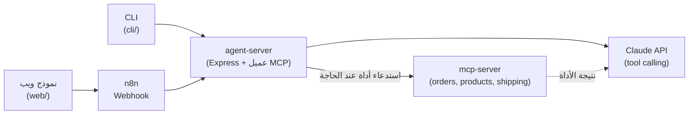

# 🤖 وكيل دعم عملاء بالذكاء الاصطناعي — MCP + n8n + VPS

## 🔗 [جرّبه الآن مباشرة](https://ai-support-agent-mcp.onrender.com)

> ⏱️ **أول طلب ياخذ ~30-50 ثانية** — منشور مجانًا بالكامل على Render، والخطة المجانية
> "تنام" بعد فترة عدم نشاط. اصبر عليه أول مرة، بعدها يرد فوري.

مشروع بورتفوليو صغير مبني خصيصًا ليغطي متطلبات وظيفة **AI Agents & Automation Engineer**:
بناء وكيل AI (Agent) باستخدام **بروتوكول MCP** لاستدعاء الأدوات (Tool Calling)، مربوط بأتمتة
**n8n** عبر **Webhook/API**، ومنشور فعليًا على **VPS**، مع **CLI** لاختباره من الطرفية.

## الفكرة

وكيل دعم عملاء لمتجر إلكتروني وهمي، يقدر يجاوب على 3 أنواع أسئلة باستخدام أدوات حقيقية
(مش تخمين من النموذج):

| السؤال | الأداة (MCP Tool) |
|---|---|
| "وش حالة طلبي رقم 1001؟" | `check_order_status` |
| "عندكم ساعات ذكية؟" | `search_products` |
| "كم مدة التوصيل لمكة؟" | `get_shipping_info` |

## Why MCP instead of direct API calls?

لأن الهدف إظهار نمط قابل لإعادة الاستخدام، مو حل مؤقت: الأدوات معرّفة مرة واحدة كسيرفر MCP
مستقل (`mcp-server/`)، فأي عميل يدعم البروتوكول — Claude، أداة CLI، أو وكيل ثاني لاحقًا —
يقدر يستخدمها بدون تعديل كود الوكيل نفسه. استدعاء API مباشر كان يشتغل لنفس الحالة الحالية،
لكنه يربط منطق الأدوات بتطبيق واحد؛ MCP يفصلهما فيصير توسيع الأدوات أو تبديل النموذج
لاحقًا تغييرًا محليًا، مو إعادة كتابة.

## البنية المعمارية



- **`mcp-server/`** — سيرفر MCP حقيقي (بروتوكول Model Context Protocol) يعرّض 3 أدوات ببيانات وهمية.
- **`agent-server/`** — يتصل كعميل MCP بالسيرفر أعلاه، ويشغّل حلقة tool-calling مع Claude API، ويعرض API عبر HTTP (`/chat`).
- **`web/`** — نموذج ويب بسيط (HTML/JS) للمحادثة مع الوكيل.
- **`cli/`** — سكربت Node.js لاختبار الوكيل مباشرة من الطرفية.
- **`n8n/`** — Workflow جاهز للاستيراد: Webhook → استدعاء الوكيل → رد.
- **`deploy/`** — Docker + docker-compose + دليل نشر كامل على VPS من الصفر.

## التشغيل محليًا

يدعم المشروع مزوّدين للذكاء الاصطناعي (قابل للتبديل عبر `PROVIDER` في `.env`):

- **`gemini`** (الافتراضي) — **مجاني بالكامل**، مفتاح من [aistudio.google.com/apikey](https://aistudio.google.com/apikey) بدون بطاقة بنكية
- **`anthropic`** — جودة أعلى، يحتاج رصيد مدفوع من [console.anthropic.com](https://console.anthropic.com/settings/keys)

```bash
npm install
cp .env.example .env
# حط GEMINI_API_KEY (مجاني) أو ANTHROPIC_API_KEY داخل .env

npm start          # يشغّل agent-server (ويشغّل mcp-server تلقائيًا كـ subprocess)
```

افتح `http://localhost:3000` للنموذج، أو من طرفية ثانية:

```bash
npm run chat -- "وش حالة طلبي رقم 1001؟"
```

## تشغيل n8n محليًا (اختياري)

```bash
docker compose -f deploy/docker-compose.yml up -d
```

افتح `http://localhost:5678`، استورد `n8n/support-agent-webhook.json`، فعّله،
وبعدها ابعث POST لـ `http://localhost:5678/webhook/support-chat` بـ body:
`{"message": "عندكم سماعات؟"}`

## النشر

- **الحالي (مجاني، بدون بطاقة):** منشور على [Render](https://render.com) — رابط حي أعلاه. يوضّح القدرة
  على نشر تطبيق Node حقيقي متصل بـMCP على الإنترنت، مع بيئة إنتاج فعلية (متغيرات بيئة، build/start commands).
- **البديل الموثّق (VPS كامل):** راجع [`deploy/VPS-SETUP.md`](deploy/VPS-SETUP.md) — دليل خطوة بخطوة
  كامل لنشر المشروع بـDocker على VPS حقيقي (Hetzner/DigitalOcean) مع تحكم كامل بالسيرفر (root access،
  firewall، Nginx، SSL) — جاهز للتنفيذ فور توفر بطاقة بنكية للتحقق.

## لماذا هذا المشروع يغطي متطلبات الوظيفة

- ✅ **AI Agents & تصميم** — `agent-server` يدير حلقة قرار/استدعاء أداة/رد كاملة
- ✅ **Agent Skills & Tool Calling** — 3 أدوات معرّفة بمخطط JSON Schema
- ✅ **بروتوكول MCP** — استخدام فعلي لـ `@modelcontextprotocol/sdk` (server + client)
- ✅ **أتمتة العمليات بـn8n** — workflow حقيقي (Webhook → HTTP Request → Respond)
- ✅ **التكامل عبر APIs وWebhooks** — REST endpoint + n8n webhook
- ✅ **إدارة VPS وHosting** — دليل نشر كامل بـDocker على سيرفر حقيقي
- ✅ **التعامل مع CLI/Terminal** — `cli/chat.js`

## Known Limitations

- **بيانات وهمية** — الطلبات/المنتجات/الشحن في `mcp-server/data.js` بيانات ثابتة لأغراض العرض؛
  في نظام حقيقي تُستبدل باتصال فعلي بقاعدة بيانات المتجر (مثل سلة أو Shopify عبر API).
- **بدون مصادقة** — لا يوجد auth على `/chat` أو على الـwebhook؛ غير مصمم لتحمّل حركة عامة أو بيانات حقيقية.
- **الخطة المجانية على Render تنام** — أول طلب بعد فترة خمول ياخذ 30-50 ثانية (موضّح بالأعلى)؛
  على VPS حقيقي (راجع `deploy/`) هذا القيد ينعدم.
- **لا اختبارات آلية** — المشروع بحجم بورتفوليو، بدون test suite حاليًا.
- **مزوّد واحد نشِط بالمرة** — التبديل بين Gemini وAnthropic يدوي عبر `.env`، مو ديناميكي وقت التشغيل.

## الترخيص

MIT — راجع [LICENSE](LICENSE).
